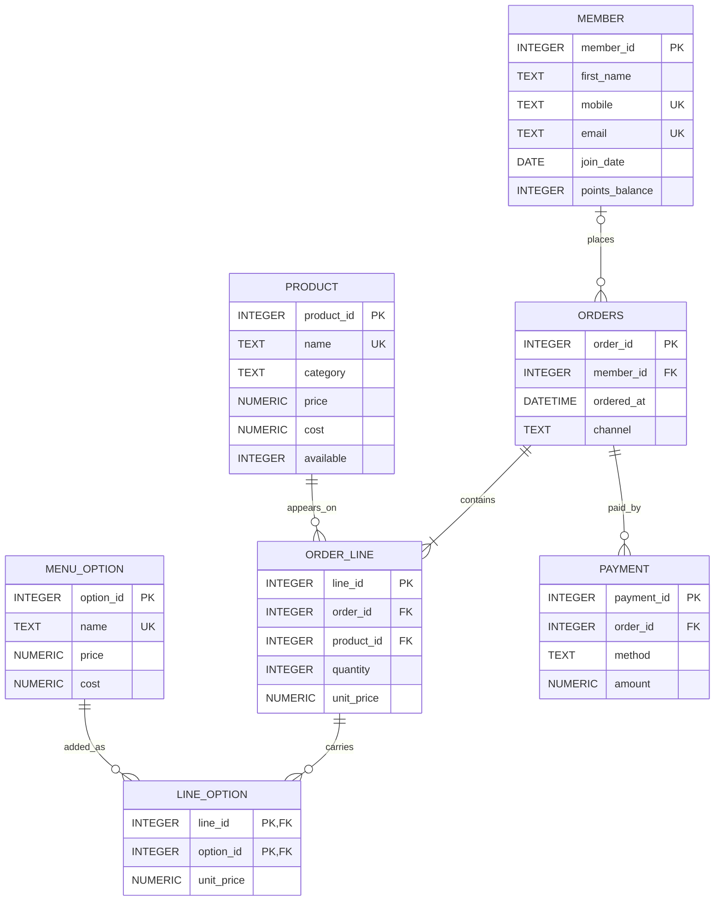

Part A · The README
Babson Bean Café: database project
1. The scenario

Babson Bean is a café on campus. Its till records sales and its loyalty program lives on punch cards, and neither can answer a question. The café wants to know what sells, which add-ons earn their keep, and who its regular customers are.

What it keeps today

Loyalty members: first name, mobile number, email (optional), join date and points balance. A member can change their mobile number. Customers who are not members buy too, and their orders name no customer.
The menu: product name, category (coffee, tea, food, other), price, cost, and whether it is available today.
Options a drink can carry: extra shot, oat milk, vanilla syrup and the like, each with a price, which can be zero, and a cost.
Orders: the date and time, the member if there is one, and the channel: counter or app.
Order lines: an order has one line or more. Each line is one product, with a quantity and the price charged that day, because a menu price can change later.
Options on a line: a line can carry several options, and an option appears on many lines. For each, the price charged that day.
Payments: an order can be paid in more than one payment, part by card and part with points. Each has a method (cash, card, app or points) and an amount in dollars, points included.
The café's revenue is what its lines and their options were charged, however the order was paid.

The rules it works by

A quantity is more than zero, and so is a payment.
On the menu, a product's price is never below its cost.
An order line belongs to exactly one order and one product, and an option on a line belongs to exactly one line.
An option appears at most once on a line, and it is charged once for every unit on the line: two lattes with oat milk pay for oat milk twice.
A payment's method is one of the four listed above.
An order's payments add up to the order's total, its lines and their options together. A CHECK cannot hold a rule that spans tables, so this one is checked with a query.
The data you need: at least 40 members, 20 products, eight options and 1,000 orders.

Business questions

The three best-selling products last month, by units.
Revenue, cost and margin by menu category, with what the options earned counted in, each option under the category of the product on its line. (three tables or more)
For each member: the number of orders, the total spent and the average order, keeping the members whose total spent is above the members' average. (three tables or more)
Every order's payments checked against its total, and a list of the orders where they do not match. (three tables or more) (checks a rule)
The members who joined and have never ordered.
The share of orders paid at least partly with points, for each month.
The products, available today or not, that have not sold in the last 60 days.
For each coffee and tea product, the average number of options on its lines, counting a line with no options as zero. (three tables or more)

You may need to total the lines and the payments of an order separately before you compare them. Joined together, every line meets every payment.

2. ERD 

Reading the lines

A member places zero or many orders; an order has at most one member (none for a customer who is not a member).
An order has one or more lines; each line belongs to exactly one order.
A product appears on zero or many lines; each line is exactly one product.
Options hang on each order line: a line carries zero or many options, through line_option.
An option appears on zero or many lines, through line_option. Its two-column key (line_id, option_id) is what stops an option appearing twice on one line.
An order is paid by zero or many payments; each payment belongs to one order. Whether they add up is checked by a query, not by the diagram.

The table is called orders because ORDER is a reserved word in SQL.

3. The tables
member: one row is one loyalty member, with a number of their own so that their mobile number can change, plus their first name, optional email, join date and points balance.
product: one row is one item on the menu, with its category, the price on the menu today, what it costs the café, and whether it can be ordered today.
menu_option: one row is one add-on a drink can carry, such as oat milk or an extra shot, with the price it adds (possibly zero) and what it costs the café.
orders: one row is one purchase at the café, with when it happened, whether it came through the counter or the app, and the member who made it, if there was one.
order_line: one row is one product on one order, with how many were bought and the price charged for each that day.
line_option: one row is one option added to one order line, with the price charged for it that day, applied to every unit on the line.
payment: one row is one payment toward one order, with how it was paid (cash, card, app or points) and the amount in dollars.

4. Design choices

Keys where the business already had one. The café already had two natural identifiers for a member, the mobile number and the email. I did not use either as the primary key. The scenario says a member can change their mobile number, and a primary key that changes has to be changed in every order that points at it. The email is optional, so some members would have no key at all. Each member gets their own member_id instead, and mobile and email are both UNIQUE, so two members can't share one (several members with no email are still allowed). Products and options have names, but a name can be reworded, so they get their own ids as well and name is UNIQUE. The one key made from business columns is line_option, where (line_id, option_id) is the primary key because it is exactly the rule "an option appears at most once on a line".

Optional relationships.

An order does not have to have a member: the scenario says customers who are not members buy too, and their orders name no customer. So orders.member_id can be empty.
A member does not have to have orders: question 5 asks for members who joined and have never ordered.
A product does not have to be on any line: question 7 asks for products that have not sold.
An order line does not have to carry options, and an option does not have to be on any line: question 8 counts a line with no options as zero.
An order is drawn as having zero or many payments. The scenario only says it can be paid in more than one payment, so this one is my choice: question 4 has to be able to find orders whose payments don't match the total, and an order with no payment at all is the clearest mismatch.
Not optional: an order line must have one order and one product, an option on a line must have one line, and an order must have at least one line.

Rules the tables cannot hold.

An order's payments add up to the order's total. The total is the lines plus their options, and the payments are in another table, so no CHECK can see both. I will check it with a query (question 4) that totals the lines and their options for each order and totals the payments for each order, each in its own subquery, then compares the two and lists the orders that differ. They have to be totalled separately first, because joining lines to payments directly would repeat every line once per payment.
An order has at least one line. A foreign key says a line must point at an order, not that an order must have a line. I will check it with a query for orders that have no line.
Everything else is held by the tables: quantity > 0 and amount > 0 and price >= cost by CHECK, the four payment methods by a CHECK ... IN, and "once per line" by the line_option key.

One thing I changed or checked. I checked that options are on the order line and not on the order or the product. The first thing I looked for in the ERD was line_option joining order_line to menu_option, so the same option can appear on many lines and a line can carry several options. I also checked that the price charged that day is stored on both order_line and line_option, so a later change to the menu price can't change old revenue.