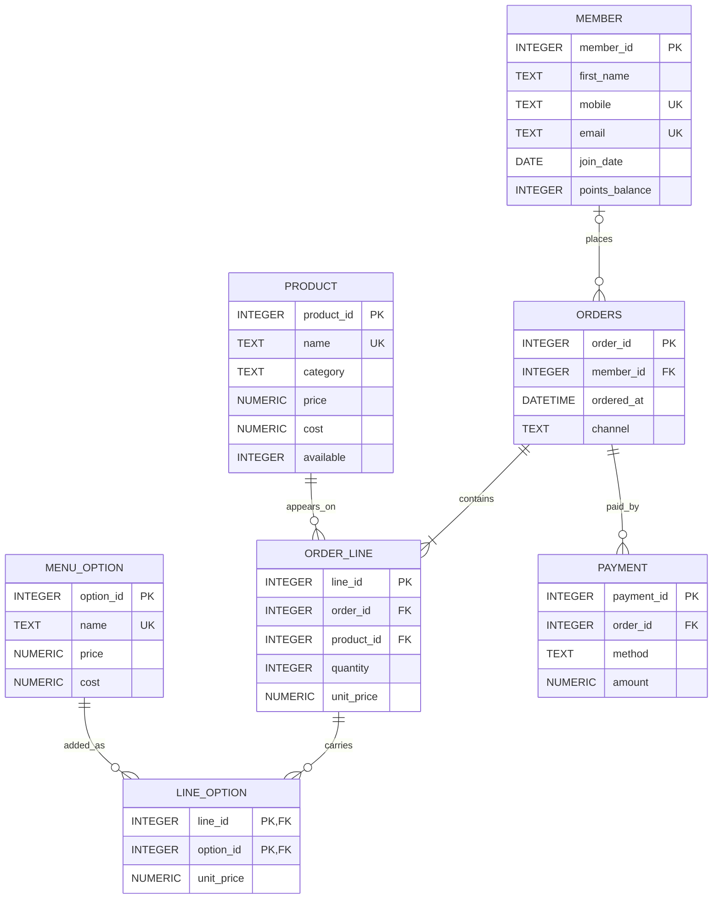

Part A · The README
Babson Bean Café: database project
1. The scenario

Babson Bean is a café on campus. Its till records sales and its loyalty program lives on punch cards, and neither can answer a question. The café wants to know what sells, which add-ons earn their keep, and who its regular customers are.

What the café keeps

Loyalty members: first name, mobile number, email (optional), join date and points balance. A member can change their mobile number. Customers who are not members buy too, and their orders name no customer.
The menu: product name, category (coffee, tea, food, other), price, cost, and whether it is available today.
Options a drink can carry: extra shot, oat milk, vanilla syrup and the like, each with a price (which can be zero) and a cost.
Orders: the date and time, the member if there is one, and the channel (counter or app).
Order lines: an order has one line or more. Each line is one product, with a quantity and the price charged that day, because a menu price can change later.
Options on a line: a line can carry several options, and an option appears on many lines. Each one records the price charged that day.
Payments: an order can be paid in more than one payment, for example part by card and part with points. Each has a method (cash, card, app or points) and an amount in dollars, points included.

Revenue is what the lines and their options were charged, however the order was paid.
The rules it works by

A quantity is more than zero, and so is a payment.
A product's price is never below its cost.
An order line belongs to exactly one order and one product, and an option on a line belongs to exactly one line.
An option appears at most once on a line, and it is charged once for every unit on the line: two lattes with oat milk pay for oat milk twice.
A payment's method is one of cash, card, app or points.
An order's payments add up to the order's total (its lines and their options together). A CHECK cannot hold a rule that spans tables, so this one is checked with a query.

The data: at least 40 members, 20 products, 8 options and 1,000 orders.

The questions the database must answer

The three best-selling products last month, by units.
Revenue, cost and margin by menu category, with what the options earned counted in, each option under the category of the product on its line.
For each member: number of orders, total spent and average order, keeping the members whose total spent is above the members' average.
Every order's payments checked against its total, and a list of the orders where they do not match.
The members who joined and have never ordered.
The share of orders paid at least partly with points, for each month.
The products, available today or not, that have not sold in the last 60 days.
For each coffee and tea product, the average number of options on its lines, counting a line with no options as zero.

2. ERD 

Reading the lines

A member places zero or many orders; an order has at most one member (none for a customer who is not a member).
An order has one or more lines; each line belongs to exactly one order.
A product appears on zero or many lines; each line is exactly one product.
Options hang on each order line: a line carries zero or many options, through line_option.
An option appears on zero or many lines, through line_option. Its two-column key (line_id, option_id) is what stops an option appearing twice on one line.
An order is paid by zero or many payments; each payment belongs to one order. Whether they add up is checked by a query, not by the diagram.

The table is called orders because ORDER is a reserved word in SQL.